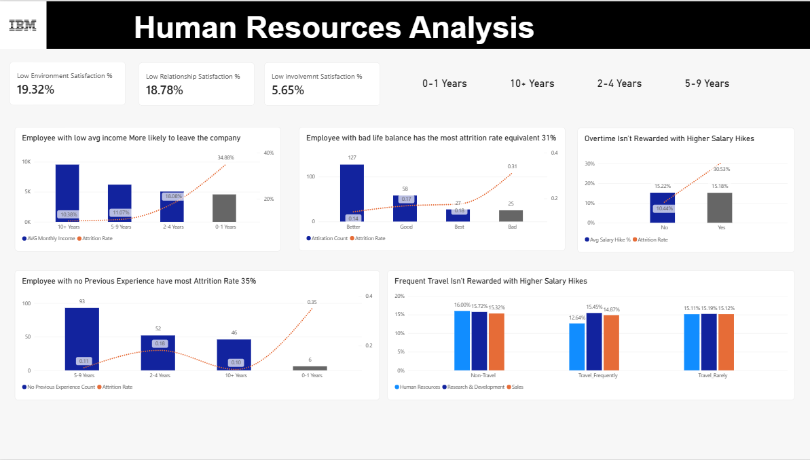

# IBM HR Analysis: Employee Attrition (Power BI)

A Power BI case study on the IBM HR Analytics dataset. It answers one business question: **who leaves the company, and what can HR change to keep them?**

- **Author:** Fatma Magdy, Data Analyst
- **Tools:** Power BI Desktop, Power Query (M), DAX
- **Report file:** `HrAnalysis` (Power BI Desktop)

The company lost **237 of 1,470 employees (16.12%)**. Every rate below is attrition rate: leavers divided by employees in the group.

## Dashboard preview

**Overview page**



**Diagnostic Analysis page**


---

## 1. Key insights

1. **New employees leave the most.** Employees with 0-1 years at the company have a **34.9%** attrition rate (75 of 215), about three times the rate of employees with 5 or more years (10-11%). They are 14.6% of staff but 31.6% of all leavers.
2. **Sales has the highest attrition rate among the large departments: 20.6%** (92 of 446). Sales is 30.3% of staff and 38.8% of leavers.
3. **HR is small but not safe.** HR has only 63 employees, yet **19.0%** of them left (12 of 63), close to Sales.
4. **Frequent travel drives HR attrition.** Among HR employees who travel frequently, **36.4%** left (4 of 11). Among HR employees who do not travel, **0%** left (0 of 6). The groups are tiny, so treat this as a signal to watch, not a proven effect. The same direction appears in the larger departments: frequent travelers leave at 33.3% in Sales and 20.3% in R&D, against about 8% for non-travelers.
5. **Travel is not paid for.** HR employees who travel frequently get an average raise of **12.64%**, which is **3.4 points lower** than HR employees who do not travel (16.00%). Sales and R&D frequent travelers get about the same raise as everyone else (14.87% and 15.45%).
6. **Overtime is not rewarded and is linked to leaving.** The average raise is 15.18% with overtime and 15.22% without. Employees who work overtime leave at **30.5%** (127 of 416), against 10.4% without overtime (110 of 1,054). Overtime staff are 28.3% of employees and 53.6% of leavers.
7. **One employee in five is unhappy with the work environment.** **19.32%** of employees (284 people) rate their environment Low. They leave at **25.4%** (72 of 284), against 13.9% for everyone else.
8. **Poor work-life balance carries a high risk.** Employees who rate their balance Bad leave at **31.3%** (25 of 80), against 14.2% for those who rate it Better. They are a small group (5.4% of staff, 10.5% of leavers), so the action is cheap but its ceiling is limited.

## 2. Recommendations

Each recommendation comes from a rate above and is tested in the what-if analysis below. The ceiling is the most leavers the action could avoid, assuming the high-risk group would leave at the rate of its comparison group.

| Rank | Action | Evidence | Ceiling (leavers avoided) |
|---|---|---|---|
| 1 | **Cap overtime** and compensate the overtime that remains | 30.5% with overtime against 10.4% without; no extra raise | about 84 (5.7 points of attrition) |
| 2 | **Fix the first year**: assign a buddy, run 30, 60 and 90-day check-ins, confirm role expectations | 34.9% in year one against 18.1% in years 2-4 | about 36 (2.5 points) |
| 3 | **Act on the work environment**: run a short survey on the Low raters, fix the top two causes | 25.4% for Low raters against 13.9% for the rest | about 33 (2.2 points) |
| 4 | **Limit frequent travel or pay for it**: rotate travel, cap travel days, add an allowance or a higher raise, and stop travel in departments whose roles do not need it | 24.9% for frequent travelers against 15.0% for rare travelers; no extra raise; HR frequent travelers get 3.4 points less | about 28 (1.9 points) |
| 5 | **Teach work-life balance** with live coaching sessions on balancing work and life, first for employees who rate balance Bad and for first-year joiners; add flexible hours or remote days | 31.3% when rated Bad against 14.2% when rated Better; first-year joiners leave at 34.9%. Employees with no previous employer leave less (11.7%), so target by balance rating and tenure, not by prior experience | about 14 (0.9 points) |
| Watch | **Sales** (20.6%), **HR frequent travelers** (n = 11), **single employees** (25.5%) | Above the 16.1% average, with overlap between groups | No ceiling set |

### What-if analysis

Each lever closes a chosen share of the gap between its high-risk group and its comparison group. At 100% the group leaves at the comparison rate. The five levers are combined as independent effects (remaining leavers = 237 × the product of each lever's remaining share), so employees who sit in several groups are not counted twice.

| Share of every gap closed | 10% | 25% | 50% | 100% |
|---|---|---|---|---|
| Leavers after all five levers | 218 | 192 | 154 | 94 |
| **Projected attrition rate** | **14.8%** | **13.1%** | **10.5%** | **6.4%** |

At a realistic 25% effect, attrition falls from 16.1% to about 13.1%, which is roughly 45 fewer leavers. Read every result as a ceiling: the data shows association, not cause. Test one lever in one team first, starting with overtime and the first-year program, which have the largest ceilings.

---

## 3. Dataset

- **Source:** IBM HR Analytics Employee Attrition & Performance (a simulated dataset published by IBM).
- **Grain:** one row per employee, 1,470 rows, 35 original columns.
- **Target column:** `Attrition` (Yes / No).
- **No date column.** The file is a single snapshot, so there is no Date dimension and no trend over time. Tenure (`YearsAtCompany`) is used as the time-like axis instead.
- **Constant columns removed:** `EmployeeCount`, `Over18`, `StandardHours` (same value for every employee).

## 4. Data model

A star schema built in Power Query.

| Table | Type | Content |
|---|---|---|
| `FactIncome` | Fact | Pay, years and tenure numbers (`MonthlyIncome`, `PercentSalaryHike`, `YearsAtCompany`, `NumCompaniesWorked`, `TotalWorkingYears` and others) plus the three keys |
| `DimEmployee` | Dimension | Attrition, Gender, AgeGroup, MaritalStatus, EducationLevel, EducationField, Job-Level, BusinessTravel, OverTime, StockOptionlevel, TenureGroup |
| `DimJobRole` | Dimension | Department and JobRole, one row per unique pair, with `JobKey` |
| `DimSatisfaction` | Dimension | One row per unique combination of the six rating columns, with `SatisfactionKey`, the original numbers and the named levels |
| `Measures_` | Measures table | Every measure lives here, not on the fact or dimension tables |

**Relationships**

| From (FactIncome) | To | Cardinality | Filter direction |
|---|---|---|---|
| `EmployeeKey` | `DimEmployee[EmployeeKey]` | One to one | Both |
| `JobKey` | `DimJobRole[JobKey]` | Many to one | Single |
| `SatisfactionKey` | `DimSatisfaction[SatisfactionKey]` | Many to one | Single |

Counts always come from the employee side (one row per employee). `DimSatisfaction` holds unique combinations, so counting its rows would count combinations, not people.

## 5. Data preparation (Power Query)

| Step | Result |
|---|---|
| Age bands | `AgeGroup`: 18-28, 29-39, 40-50, 51-60 |
| Education | `Education` 1-5 mapped to Below College, College, Bachelor, Master, Doctor |
| Job level | `JobLevel` 1-5 mapped to Entry Level, Mid Level, Senior, Manager, Director / Executive |
| Stock options | `StockOptionLevel` 0-3 mapped to No Stock Options, Low, Medium, High |
| Satisfaction ratings | Six rating columns mapped to named levels in one `List.Accumulate` step (Low to Very High, Bad to Best, and the performance labels) |
| Tenure | `TenureGroup` from `YearsAtCompany`: 0-1, 2-4, 5-9, 10+ years |
| Keys | `EmployeeKey`, `JobKey`, `SatisfactionKey` |

The original numeric columns are kept next to the named ones so the named columns can use **Sort by column** (otherwise Power BI sorts "Bachelor, Below College, Doctor" alphabetically).

## 6. Measures

All measures are in `Measures_`.

```dax
TotalEmp = COUNT ( DimEmployee[EmployeeNumber] )

Attiration Count =
CALCULATE ( COUNT ( DimEmployee[Attrition] ), DimEmployee[Attrition] = "yes" )

Attrition Rate =
DIVIDE ( CALCULATE ( [TotalEmp], DimEmployee[Attrition] = "Yes" ), [TotalEmp] )
```

Other measures in the model: `AVG Monthly Income`, `Low Environment Satisfaction %`, `Low Relationship Satisfaction %`, `Low involvemnt Satisfaction %`, `Outstanding Performance %`, `No Previous Experience Count`, `Avg Salary Hike %`.

> `Attiration Count` and `involvemnt` are misspelled in the model. Rename them (Power BI updates every visual that uses them) before publishing.

**Rule used throughout:** compare groups by **rate**, not by count. A large group always has more leavers, so counts alone mislead.

## 7. Report pages

The report has two pages. The recommendations and what-if analysis are in section 2.

| Page | Purpose | Content |
|---|---|---|
| Overview | Descriptive: what happened | KPIs (1,470 employees, 237 leavers, 16.12%), then attrition by gender, age group, department, marital status, tenure, and business travel by department |
| Diagnostic Analysis | Diagnostic: why | Low-satisfaction KPIs, pay by tenure, work-life balance, overtime and raises, prior experience, travel and raises |

## 8. Detailed findings

Company average: **16.12%** (237 of 1,470).

| Segment | Attrition rate | Leavers / employees |
|---|---|---|
| Overtime: yes / no | 30.5% / 10.4% | 127 / 416 and 110 / 1,054 |
| Tenure 0-1 years | 34.9% | 75 / 215 |
| Tenure 2-4 years | 18.1% | 66 / 365 |
| Tenure 5-9 years | 11.1% | 58 / 524 |
| Tenure 10+ years | 10.4% | 38 / 366 |
| Travels frequently | 24.9% | 69 / 277 |
| Travels rarely | 15.0% | 156 / 1,043 |
| Does not travel | 8.0% | 12 / 150 |
| Sales department | 20.6% | 92 / 446 |
| Human Resources | 19.0% | 12 / 63 |
| Research & Development | 13.8% | 133 / 961 |
| Single | 25.5% | 120 / 470 |
| Married | 12.5% | 84 / 673 |
| Divorced | 10.1% | 33 / 327 |
| Age 18-28 | 28.3% | 73 / 258 |
| Age 29-39 | 15.5% | 107 / 690 |
| Age 40-50 | 10.3% | 39 / 379 |
| Age 51-60 | 12.6% | 18 / 143 |
| Male / Female | 17.0% / 14.8% | 150 / 882 and 87 / 588 |
| Work-life balance Bad | 31.3% | 25 / 80 |
| Work-life balance Good / Better / Best | 16.9% / 14.2% / 17.6% | 58 / 344, 127 / 893, 27 / 153 |
| Low environment satisfaction | 25.4% | 72 / 284 (19.32% of staff) |
| Low relationship satisfaction | 20.7% | 57 / 276 (18.78% of staff) |
| Low job involvement | 33.7% | 28 / 83 (5.65% of staff) |

**Business travel by department**

| Travel | HR | R&D | Sales |
|---|---|---|---|
| Does not travel | 0.0% (0 / 6) | 8.2% (8 / 97) | 8.5% (4 / 47) |
| Travels rarely | 17.4% (8 / 46) | 12.9% (88 / 682) | 19.0% (60 / 315) |
| Travels frequently | 36.4% (4 / 11) | 20.3% (37 / 182) | 33.3% (28 / 84) |

**Average raise (PercentSalaryHike) by travel and department**

| Travel | HR | R&D | Sales |
|---|---|---|---|
| Does not travel | 16.00% | 15.72% | 15.32% |
| Travels rarely | 15.11% | 15.19% | 15.12% |
| Travels frequently | 12.64% | 15.45% | 14.87% |

**Pay:** average monthly income is 4,787 for leavers against 6,833 for stayers. By tenure it is 4,565 (0-1 years), 5,045 (2-4), 6,196 (5-9) and 9,534 (10+). Income and tenure rise together, so this cannot isolate pay.

**Prior experience:** 197 employees have no previous employer. Only 6 of them are in their first year (4 left), which is too small to act on. Most first-year joiners (209 of 215) arrived with experience. Across all tenures, employees with no previous employer leave at 11.7% (23 of 197), below the 16.1% average, so first-time workers are not the higher-risk group.

## 9. Limitations

- Snapshot data with no dates: no trend, no time of leaving.
- The data is association only. Overtime, travel and tenure overlap, so effects are not independent.
- Small groups move a lot with each leaver: HR (63 employees), HR frequent travelers (11), HR non-travelers (6), low job involvement (83) and bad work-life balance (80).
- The dataset is simulated, so patterns are cleaner than in real company data.

## 10. How to open

1. Open `HrAnalysis` in Power BI Desktop (the source Excel path in Power Query must point to your copy of the file).
2. Select **Refresh** if the path changed.
